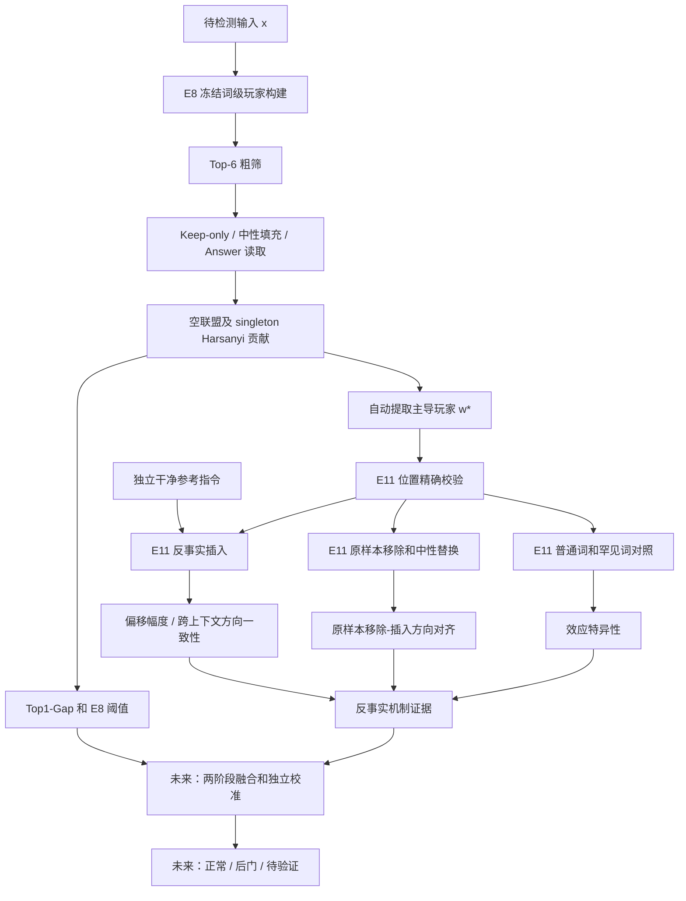

# InteractionPrism · 当前两阶段完整算法

**第一阶段（E8R1，冻结）**：输入文本 → tokenizer / 词级玩家 → Mid-layer 屏蔽粗筛 Top-6 → Keep-only + 中性填充 + `\nAnswer:` → 参考中心校正 → `v(∅), v({w_i})` → singleton Harsanyi 一阶贡献 → `Top1-Gap` → 冻结阈值与 E8 结果；同时输出 `w*`。

**第二阶段（E11R1，探索验证）**：从 E8 自动选出的 `w*`，基于原始 token 边界定位 → 独立干净参考集插入 → 原始样本移除/中性替换 → 同模型普通词与罕见词对照 → 表征幅度、方向一致性、插入-移除方向对齐 → 不预设目标回答的输出变化审计。

**最终融合（尚未研究/实现）**：汇总 E8 结果和二阶段反事实证据，建立经独立校准的三态判定规则（正常 / 后门 / 需进一步验证），不能直接凭空设定阈值。

`E10R1-R3`：已知 BadMagic 机制实验，位于第二阶段研发支线上，不能视为未知触发器的通用验证。

## Mermaid 流程图

